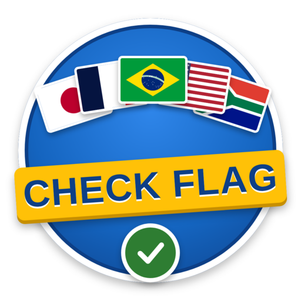

<p align="center">
  
</p>

<h1 align="center">Check Flag</h1>

<p align="center">
  Jogo de quiz de bandeiras feito em Flutter.<br>
  <b>Programação para Dispositivos Móveis</b>.
</p>

<p align="center">
  
  
  
</p>

---

## Sobre o jogo

O jogador vê a bandeira de um país e escolhe, entre 4 opções, qual é o país correto antes que o tempo acabe. No fim da partida, aparece o resultado e o jogador pode salvar a pontuação no ranking com o seu nome.

O app funciona **totalmente offline**: as 194 bandeiras, os sons e a música ficam dentro do próprio aplicativo.

## Vídeo de demonstração

_[Link do Vídeo](https://youtu.be/WbH9fIsZgBQ)._

## Funcionalidades

- [x] Jogar por continente: África, América, Ásia, Europa e Oceania
- [x] Jogo aleatório com países do mundo inteiro
- [x] Tempo de partida configurável: 30 s, 60 s, 3 min ou 5 min
- [x] Bandeira no topo, 4 opções de resposta e temporizador
- [x] Mostra se acertou ou errou e vai sozinho para a próxima pergunta
- [x] Banco de bandeiras em JSON, organizado por continente
- [x] Pontuação a cada acerto e fim de jogo quando o tempo acaba
- [x] Tela de resultado com perguntas respondidas, acertos e percentual, e botão para voltar ao menu
- [x] Navegação com `Navigator` e estado com `setState`
- [x] Pontuações salvas com `shared_preferences`
- [x] **Dificuldade:** Fácil (78 países conhecidos) ou Difícil (todos os 194)
- [x] **Ranking:** top 10 com o nome do jogador, filtro por tempo e recorde
- [x] **Idiomas:** português, inglês e espanhol, inclusive nos nomes dos países
- [x] **Animações:** bandeira desliza, pula no acerto e treme no erro; botões e placar animados

- Galeria com as 194 bandeiras, busca (sem precisar de acento) e filtro por continente
- Música de fundo e efeitos sonoros
- Tela de configurações com volume da música e dos efeitos, idioma, tempo e dificuldade
- Revisão dos erros no fim da partida
- Logo e ícone próprios

## Telas

| Tela | O que faz |
| --- | --- |
| Menu | Logo, recorde, modos de jogo e acesso à galeria, ranking e configurações |
| Continentes | Escolha do continente, com a quantidade de países de cada um |
| Jogo | Bandeira, 4 opções, tempo, pontos e animações |
| Resultado | Respondidas, acertos, percentual, nome para o ranking e revisão dos erros |
| Ranking | As 10 melhores partidas, com filtro por tempo |
| Galeria | Todas as bandeiras, com busca e filtro |
| Configurações | Música, efeitos, idioma, tempo e dificuldade |

## Como rodar o projeto

**Pré-requisitos**

- [Flutter](https://docs.flutter.dev/get-started/install) instalado (`flutter --version` para conferir)
- Android Studio com um emulador, ou um celular Android com depuração USB
- No Windows: ativar o **Modo de Desenvolvedor** (`start ms-settings:developers`), exigido pelo Flutter para usar plugins

**Passos**

```bash
git clone https://github.com/SEU_USUARIO/check_flag.git
cd check_flag
flutter pub get
flutter run
```

**Rodar os testes**

```bash
flutter test
```

**Gerar o APK**

```bash
flutter build apk --release
```

O arquivo fica em `build/app/outputs/flutter-apk/app-release.apk`.

## Recursos utilizados

| Recurso | Uso no projeto |
| --- | --- |
| Flutter e Dart | Framework e linguagem |
| Material Design 3 | Toda a interface (`Scaffold`, `AppBar`, botões, `Card`, `ListTile`, `GridView`, `Slider`...) |
| [`shared_preferences`](https://pub.dev/packages/shared_preferences) | Salvar ranking, recorde e configurações no celular |
| [`audioplayers`](https://pub.dev/packages/audioplayers) | Música de fundo e efeitos sonoros |
| `Timer` (`dart:async`) | Cronômetro da partida |
| `jsonDecode` / `jsonEncode` (`dart:convert`) | Ler o banco de países e salvar o ranking |
| Widgets de animação do Flutter | `AnimatedSwitcher`, `AnimatedContainer`, `TweenAnimationBuilder`, `AnimationController` |
| [hampusborgos/country-flags](https://github.com/hampusborgos/country-flags) | Imagens das bandeiras (domínio público), convertidas para PNG |

Os sons, a música e a logo foram criados para este projeto.

## Organização do código

```
lib/
├── main.dart                  Ponto de entrada do app
├── telas/                     As 7 telas do app
├── componentes/               Widgets reutilizáveis (bandeira, botão de resposta, diálogo)
├── modelos/                   Classes de dados (país, pergunta, resultado...)
├── logica/motor_quiz.dart     Sorteio das perguntas e das alternativas
├── dados/                     Leitura do arquivo de países
├── servicos/                  Ranking, preferências e áudio
├── idiomas/textos.dart        Textos em português, inglês e espanhol
└── tema/tema_app.dart         Cores e tema
assets/
├── dados/paises.json          194 países em 5 continentes
├── bandeiras/                 Imagens das bandeiras (br.png, jp.png...)
├── sons/                      Música e efeitos
└── imagens/logo.png           Logo do jogo
test/                          Testes da lógica do jogo
```

**Autor:** Vinícius Vieira Romão
